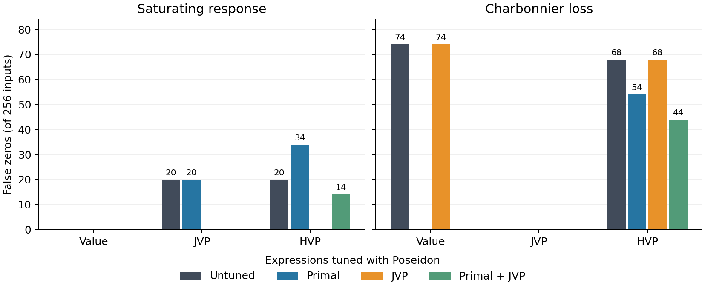

# Does tuning a value also improve its gradient?

We applied Poseidon to the source, the Enzyme-generated JVP, both, or neither.
Then we differentiated the resulting JVP again. Every column was executed as
float32 TTIR compiled for an RTX 5090 and compared against the original
function's analytic value, directional derivative and curvature at 100 decimal
digits. Each case uses 256 logarithmically spaced input magnitudes from
2⁻²⁷ to 2²⁸. Charbonnier alternates signs. The tangent cycles through four
nonzero values. These stress inputs describe a numerical regime.

For **x/(1+x)**, baseline AD returned 20 zero tangents where the mathematical
derivative was nonzero. Tuning the JVP removed all 20 and bounded the observed
error at 3 ULP. Tuning only the JVP also gave the best curvature here, at
5 ULP worst case. When Poseidon tuned the primal, Herbie chose to return x
for |x| ≤ 2⁻²⁴. This is accurate for the value but has zero mathematical second
derivative. Differentiating that branch gave 14 false HVP zeros even after
tuning the JVP.

For the **Charbonnier loss**, √(1+x²)−1, source tuning removed all 74 false
zeros in the value. Every JVP was already within 2 ULP of reference before
tuning. Curvature remained difficult, with 44 false HVP zeros even when both
stages were tuned. The loss is the α = 1, c = 1 case of
[Barron's robust loss](https://openaccess.thecvf.com/content_CVPR_2019/html/Barron_A_General_and_Adaptive_Robust_Loss_Function_CVPR_2019_paper.html).



## Reproduce

Use the `vim/tritonrev` Enzyme-JAX compiler and a Triton-enabled build of
this Poseidon branch. The exact revisions and binary hashes are in
`results/device.json`. To build with Triton's source and the matching LLVM,
configure Enzyme with the following options and build `poseidon-mlir-opt`.

```sh
cmake -S enzyme -B build -G Ninja -DCMAKE_BUILD_TYPE=Release \
  -DENZYME_POSEIDON=ON -DPOSEIDON_MLIR=ON \
  -DPOSEIDON_TRITON_SOURCE_DIR="$TRITON_SRC" -DTRITON_BUILD_UT=OFF \
  -DLLVM_SYSPATH="$LLVM_BUILD" -DLLVM_DIR="$LLVM_BUILD/lib/cmake/llvm" \
  -DMLIR_DIR="$LLVM_BUILD/lib/cmake/mlir" -DTRITON_CACHE_PATH="$PWD/build/triton-cache"
cmake --build build --target poseidon-mlir-opt
```

From this directory with the two optimizers on PATH:

```sh
python generate.py --answers results/answers --out run
python measure.py --run run
python plot.py run/metrics.csv false-zeros.png
```

To search again, replace `--answers results/answers` with
`--herbie /path/to/herbie`. The saved experiment used the default Herbie
platform and selected the lowest estimated error among buildable candidates
that strictly improved on the original score. It excluded `math.copysign`,
which the pinned TTIR-to-TTGPU converter could not legalize. The saved answers
are real Herbie reports for these source files and this compiler revision.
Pass `--platform` with an appropriate Herbie cost model to change the search.

`run/{saturate,charbonnier}/*-hvp.mlir` contains the actual three-function
modules. `measure.py` links each to a GPU entry point and saves its TTIR and
PTX. Its CUDA environment needs a driver-compatible ptxas; the local run
set `TRITON_PTXAS_PATH` to the CUDA toolkit's assembler. Contraction is
disabled in the compiler options; an explicit fused operation still computes
an FMA. The raw observations are in `results/accuracy.csv.gz`.

This experiment uses the MLIR pass from [Enzyme PR 3703](https://github.com/EnzymeAD/Enzyme/pull/3703),
which searches FPCore expressions with Herbie. Enzyme generates the measured
first and second derivatives. The LLVM Poseidon plugin's AD-based profiling
and candidate cost model are separate experiments.
