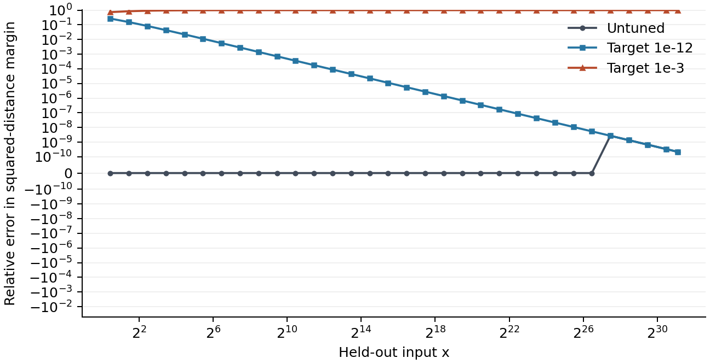

# Poseidon profiles a Triton loss and its gradient on CUDA

A difference of squared distances has an exact value of 2x + 1 and a JVP of
2dx. We write the distances separately in TTIR, generate the JVP with Enzyme,
then ask the LLVM Poseidon solver to optimize each lowered device function.
Both stages see the same RTX 5090, calibration inputs and target cost model.

| GPU kernel | Primal chosen by solver | Estimated relative error | Worst observed relative error | Exact JVPs |
|---|---|---:|---:|---:|
| Untuned | (x + 1)² − x² | — | 2.71 × 10⁻⁹ | 32/32 |
| Target 10⁻¹² | 2x | 3.10 × 10⁻¹⁶ | 26.7% | 32/32 |
| Target 10⁻³ | 1 | 7.18 × 10⁻⁷ | ≈100% | 32/32 |

For x = 1.375, the GPU returned 3.75, 2.75 and 1.0 respectively. Both tuned
JVP kernels emitted dx + dx. The solver models error over the profiled
workload. Its estimated error and the worst error on independent points are
different statistics. Mean observed primal relative errors were 1.85% and
98.15% at the two targets. This is a reason to validate value and gradient
outputs individually before accepting a candidate.



Poseidon's CUDA runtime collected gradient-weighted values from real Enzyme
reverse probes at every arithmetic instruction. Each of the 32 launches used
one warp. The 1,024 records at the JVP's x+1 intermediate gave an accumulated
adjoint of 1,008, exactly 32 × Σ 2dx. The script checks the corresponding
primal adjoint Σ 2(x+1) too. Calibration used x = 1.125 × 2ⁱ for i from 0
to 31. Each held-out x differs from every training x and lies within their
range. The first 31 are 1.375 × 2ⁱ and the last is 1.0625 × 2³¹. The tangent
cycles through 0.25, 0.5 and 0.75.

## Rerun

Use the LLVM 21.1.8 release-compatible toolchain, CUDA 12.9 nvcc and the
Poseidon Explorer archive identified in `results/metadata.json`. Its plugins
and Herbie executable come from the same release. This experiment requires
an RTX 5090 with the shipped cost model.

```sh
export LLVM_BIN=/path/to/llvm-21/bin
export POSEIDON_RELEASE=/path/to/poseidon-explorer-llvm21
export NVCC=/path/to/cuda-12.9/bin/nvcc
export TRITON_PTXAS_PATH="$(dirname "$NVCC")/ptxas"
python prepare.py --opt /path/to/enzymexlamlir-opt --out run
./run.sh run
python report.py run
```

`prepare.py` keeps the two scalar TTIR functions visible at the LLVM
boundary and wraps their calls with the Poseidon marker. Triton emits them
with LLVM's internal fast calling convention. At the marker boundary both
sites need the C calling convention used by the profiling plugin. It also
sets their target CPU to match the sm_120 cost model. The four-argument
TTIR entry acquires two extra scratch pointers in Triton's lowering.

`run.sh` links the instrumented device code against Poseidon's CUDA runtime,
then uses the collected profiles for two independent solves. A native CUDA
kernel wrapper registers the device function for launch. The control uses
Triton's original LLVM and the same launch wrapper. Every reported value
comes from copying both CUDA outputs back to the host. The independent
algebraic references are evaluated with 100 decimal digits. The measured
costs in the explanation files are solver cost units.

The raw samples, instruction profiles, solver explanations, exact accepted
Herbie expressions and emitted LLVM bodies are in `results/`. The optimizer
and Herbie search were run twice from separate output directories, giving
the same held-out results in both runs.
